<p align="center">
  
</p>

<h1 align="center">CelularBox · PhoneBox</h1>

<p align="center">
  <b>Transform any spare Android phone into an ultra-responsive, full-featured Desk Deck, Hardware Monitor, and Real-Time PC Audio Streamer.</b>
</p>

<p align="center">
  <a href="https://github.com/hneemias/android-deck/actions/workflows/build.yml"></a>
  <a href="https://github.com/hneemias/android-deck/releases/latest"></a>
  
  
  
  <a href="LICENSE"></a>
</p>

<p align="center">
  <b>Translations:</b>
  <a href="docs/README.pt.md">Português</a> ·
  <a href="docs/README.tr.md">Türkçe</a> ·
  <a href="docs/README.de.md">Deutsch</a> ·
  <a href="docs/README.fr.md">Français</a> ·
  <a href="docs/README.es.md">Español</a> ·
  <a href="docs/README.it.md">Italiano</a> ·
  <a href="docs/README.nl.md">Nederlands</a> ·
  <a href="docs/README.pl.md">Polski</a> ·
  <a href="docs/README.ru.md">Русский</a> ·
  <a href="docs/README.el.md">Ελληνικά</a> ·
  <a href="docs/README.vi.md">Tiếng Việt</a> ·
  <a href="docs/README.zh.md">中文 (简体)</a>
</p>

> [!NOTE]
> **Origem & Reconhecimento / Origin & Attribution:**  
> Este projeto é uma evolução / fork melhorado do incrível projeto de código aberto **[PhoneBox](https://github.com/ersinkoc/phonebox)** criado por **[Ersin Koç](https://github.com/ersinkoc)**.  
> Esta versão introduz pareamento Wi-Fi e distribuição de APK 100% in-house/local (sem redirecionamentos externos para o GitHub), monitoramento de bateria de periféricos sem fio (**Razer Synapse / HID** e **Logitech G / HID++**), correções de estabilidade no Discord RPC, suporte a streaming de áudio do PC para o celular em tempo real e localização refinada. Todos os créditos da arquitetura base original pertencem a Ersin Koç e aos colaboradores do PhoneBox!

---

<p align="center">
  
</p>

## 💡 Why CelularBox?

Why spend \$150+ on a proprietary macro keypad when that unused Android phone sitting in your drawer has:
- ✨ **A crisp, high-density touchscreen** with rich animations and haptic feedback.
- 📶 **High-speed Wi-Fi and USB connectivity**.
- 🔋 **Built-in battery and independent power management**.
- 🔒 **100% Offline & Private:** Zero accounts, zero telemetry, zero cloud dependencies. All data stays strictly between your PC and your phone on your local network.

CelularBox pairs a lightweight **desktop agent** (.NET 10) with an optimized, hardware-accelerated **Android application**. Design your dream control panel directly in your browser with **125 widgets** and **30 templates** across multiple customizable grid pages!

---

## ⚡ Superpowers & Key Features

```mermaid
flowchart LR
    subgraph PC ["🖥️ Host Computer (Agent)"]
        A["Hardware Metrics<br/>(CPU, GPU, RAM, Net)"]
        B["Peripheral Batteries<br/>(Razer, Logitech, etc.)"]
        C["Audio Engine<br/>(App Volume & WASAPI Stream)"]
        D["Control Deck<br/>(Shortcuts, OBS, Spotify)"]
        E["AI Quotas & Sessions<br/>(Claude, Codex, Antigravity)"]
    end

    subgraph Net ["📡 Local Network / USB"]
        USB["🔌 USB (adb reverse)"]
        WIFI["📶 Wi-Fi / Tailscale (TLS Pinned)"]
    end

    subgraph Phone ["📱 CelularBox (Android Panel)"]
        P1["Touch Deck & Macro Pad"]
        P2["Real-Time Hardware Graphs"]
        P3["Discord Voice Station"]
        P4["PC Audio Listening (Headphones)"]
    end

    PC <--> Net <--> Phone
```



### 🖥️ Hardware & Battery Intelligence
* **Full PC Telemetry:** Live CPU, GPU (NVIDIA, AMD, Intel, Apple Silicon), RAM usage, NVMe/Disk I/O, network traffic speeds, and ping latency charts.
* **Wireless Peripherals Battery Monitor:** Real-time battery percentages for wireless mice, keyboards, and headsets from **Razer** (Synapse/HID), **Logitech G** (G HUB / HID++ 2.0), Corsair, and SteelSeries.

### 🎧 Real-Time PC Audio Streaming (*Listen to PC*)
* Stream your computer's master audio output directly to your phone's speaker or connected headphones with low-latency WASAPI loopback capture and Web Audio API playback.

### 🎮 Ultimate Control Deck & Macro Pad
* **Per-App Volume Sliders:** Adjust Spotify, Discord, or game volume independently right from your desk.
* **Quick Shortcuts & Macros:** Launch applications, open workspace folders, execute complex keyboard chords, trigger PowerShell/Bash scripts, and type predefined text snippets.
* **OBS Studio & Media Control:** Switch scenes, start/stop streams and recordings, toggle mute, and control playback (Spotify, YouTube, VLC).
* **Smart Home Integration:** Direct entity and toggle control for **Home Assistant**.

### 🤖 AI Developer Cockpit
* Monitor live quotas, daily burn rates, token usage, and reset countdowns for **Claude Code**, **Codex**, and **Google Antigravity**.
* **1-Tap Terminal Approvals:** Answer Claude Code tool permission requests (*Allow / Deny*) directly from the phone screen without leaving your editor.

### 🎙️ Discord Voice Station
* Live voice channel participant list, speaking avatars, active channel name, and quick mute / deafen / disconnect touch controls.

### 📱 100% In-House Pairing & Distribution
* **Zero External Redirects:** The PC agent serves the Android APK (`/download`) and pairing landing page (`/pair`) directly.
* **Instant QR Code Wi-Fi Pairing:** Scan once with your phone's camera to establish an encrypted TLS connection with cryptographic certificate pinning.

---

## 🎛️ What You Can Display

| Category | On the Phone Screen |
| :--- | :--- |
| **PC Health** | Real-time CPU, GPU, RAM, Disk speeds, Network I/O, Ping latency, Process manager |
| **Gear Batteries** | Razer mice/dock, Logitech G peripherals, and laptop charge status |
| **AI Assistants** | Claude Code, OpenAI Codex, Antigravity quotas, session timers, and prompt permissions |
| **Audio & Media** | Per-app audio mixer, master volume, Now Playing album art, track progress, Spotify controls |
| **Streaming** | OBS scene switcher, stream/recording status, mic mute, emergency panic button |
| **Shortcuts** | Custom app launcher, terminal triggers, keyboard shortcuts, window tiling presets |
| **Daily Life** | Clock, weather forecasts (Open-Meteo), digital photo frame gallery, calendar, Pomodoro timers |
| **Discord** | Voice channel members, speaking status, mute/deafen toggles, channel hopping |

---

## 🚀 Quick Start

### Prerequisites
* **Computer:** Windows 10/11 (x64), Linux (x64/ARM64), or macOS (Apple Silicon/Intel).
* **Phone:** Any Android device running **Android 5.0 (Lollipop) or newer** (Android 7+ recommended).

---

### Step 1: Install the Desktop Agent

#### Windows (Standalone / Self-Contained)
1. Download the latest **`CelularBox-Completo.zip`** from [Releases](https://github.com/hneemias/android-deck/releases/latest).
2. Extract the folder and double-click **`PhoneBoxAgent.exe`**.
3. *No .NET installation or runtimes required!* The agent starts in your system tray and opens the settings page at `http://127.0.0.1:8765`.

*Or install via PowerShell:*
```powershell
irm https://raw.githubusercontent.com/hneemias/android-deck/main/setup.ps1 | iex
```

#### Linux & macOS
Run the automated installer:
```bash
curl -fsSL https://raw.githubusercontent.com/hneemias/android-deck/main/setup.sh | bash
```

---

### Step 2: Install the Android App

* **Via PC QR Code:** Open settings on your PC (`http://127.0.0.1:8765`), click **"Pair a phone over Wi-Fi"**, and scan **QR Code 1** with your phone to download `CelularBox-App.apk` directly from your PC.
* **Via Direct Download:** Download `CelularBox-App.apk` from the [Releases](https://github.com/hneemias/android-deck/releases/latest) page and install it on your Android device.

---

### Step 3: Connect & Pair

| Connection Type | How It Works |
| :--- | :--- |
| **📶 Wi-Fi / Tailscale (Cable-Free)** | In PC Settings (`http://127.0.0.1:8765`), open **General → Wi-Fi & Tailscale → Pair a phone over Wi-Fi**. Scan **QR Code 2** with your phone's camera. Tap confirm on the matching security check code. Done! |
| **🔌 USB (Zero Configuration)** | Enable **Developer Options → USB Debugging** on the phone, plug in a USB cable, and accept the prompt. The panel opens automatically. |

---

## 🎨 Visual Page Designer

Open **`http://127.0.0.1:8765/settings/#pages`** in your browser to design your layout:
* **12 × 6 Modular Grid:** Place and resize widgets freely.
* **Smart Stacks:** Group up to 12 widgets into a single swipeable card.
* **Appearance Customization:** Tweak fonts, borders, background transparency, and accent colors globally or per-widget.
* **Live Preview:** Test responsive layouts and widgets on your PC screen before saving.

<p align="center">
  
</p>

---

## 🛡️ Security & Privacy Architecture

* **Isolated Local Server:** The desktop settings server listens on `127.0.0.1:8765` with origin verification to prevent DNS rebinding and cross-site scripting.
* **Encrypted Wi-Fi Protocol:** Wireless panel traffic runs over TLS on port `8766` using a **cryptographically pinned self-signed certificate**. The phone rejects any connection whose certificate does not match the paired SHA-256 fingerprint.
* **Zero Telemetry:** No analytics, tracker SDKs, or cloud proxies. Your keystrokes, shortcuts, credentials, and PC data never leave your local network.

---

## 💻 Tech Stack & Architecture

* **Desktop Agent:** C# / .NET 10, ASP.NET Core Minimal APIs, Kestrel Web Server, NAudio, Windows Media Session APIs, Windows Forms System Tray.
* **Android Application:** Kotlin, AndroidX WebKit, Hardware-Accelerated WebView, Bi-directional JS Bridges.
* **Web Panel & Widgets:** Vanilla JavaScript (ES6+), CSS Custom Properties, SVG Icons, Web Audio API, Server-Sent Events (SSE).

---

## 🛠️ Development & Building from Source

```bash
# Clone the repository
git clone https://github.com/hneemias/android-deck.git
cd android-deck

# Run tests
dotnet test agent/PhoneBox.Agent.Tests

# Build and run the desktop agent
dotnet run --project agent/PhoneBox.Agent/PhoneBox.Agent.csproj -f net10.0-windows10.0.19041.0

# Build the Android APK (requires JDK 17)
cd android
./gradlew assembleDebug
```

---

## 👏 Credits & Attribution

This project is built upon the solid foundation of **[PhoneBox](https://github.com/ersinkoc/phonebox)**, created and maintained by **[Ersin Koç](https://github.com/ersinkoc)** under the MIT License.

A special thanks to Ersin Koç and the contributors of PhoneBox for designing the initial system architecture, the clean UI aesthetic, and the virtual layout editor.

---

## 📄 License

This project is licensed under the **[MIT License](LICENSE)**.
Feel free to use, modify, and distribute it for personal and commercial purposes.

<p align="center">
  <b>Built with ❤️ for hackers, makers, gamers, and productivity enthusiasts.</b><br>
  <i>Give this repository a ⭐ if you found it useful!</i>
</p>
